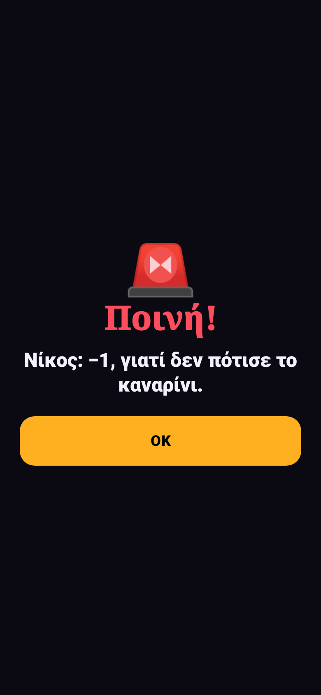

<h1 align="center">Gamenight GR</h1>

<b>28 παιχνίδια παρέας σε ένα κινητό.</b> 
Ένα κινητό, που περνάει από χέρι σε χέρι. Χωρίς internet, χωρίς λογαριασμό, χωρίς διαφημίσεις.

  

Android 10+ · 1 έως 7 παίκτες ή ομάδες · ελληνικά και English · ανοιχτός κώδικας (MIT) · offline · αυτόματες ενημερώσεις

*[English below](#english)*

## Τι είναι

Μια εφαρμογή για βραδιές με φίλους. Γράφετε τους παίκτες (ή φτιάχνετε ομάδες), διαλέγετε παιχνίδι και το κινητό πηγαίνει από χέρι σε χέρι. Οι πόντοι μαζεύονται σε όλα τα παιχνίδια της βραδιάς, και στο τέλος υπάρχει κατάταξη και απονομή βραβείων.

Όλο το περιεχόμενο (πάνω από 2.000 κάρτες) είναι γραμμένο από την αρχή στα ελληνικά, με ελληνικά τραγούδια, ταινίες, φαγητά και πειράγματα. Υπάρχει και αγγλική έκδοση για τις ξένες παρέες.

## Τα παιχνίδια

| | Κατηγορία | Παιχνίδια |
|---|---|---|
| 🕵️ | **Κρυφοί ρόλοι** | 🏚️ Το στοιχειωμένο σπίτι (με αφηγητή) · 👽 Ο Εξωγήινος · 🧨 Ο Σαμποτέρ · 🎨 Ένας λείπει |
| 🗣️ | **Λέξεις** | 🗣️ Πες το αλλιώς · 🤳 Στο μέτωπο · 🟨 Τετράδες · 💣 Ναρκοπέδιο · 🔟 Βρες 10 · 🔗 Σχετικές λέξεις |
| 🤥 | **Μπλόφα και γνώσεις** | 🃏 Ο Μπλοφατζής · 🤥 Ψέμα υπό πίεση · 🔍 Ο Μάρτυρας · 🎬 Μάντεψε την ταινία ή σειρά |
| 🎭 | **Θέατρο, τραγούδι, ζωγραφική** | 🔢 Το νούμερό σου · 📞 Χαλασμένο τηλέφωνο · 🎤 Λέξη σε τραγούδι |
| ⚡ | **Αντανακλαστικά** | ⏱️ Βόμβα · ⚖️ Ισορροπία (με το γυροσκόπιο) |
| 🎮 | **Arcade** | 🌈 Χρωματική πύλη · 🕳️ Βουτιά · 🔢 Γρήγορο πλέγμα · 🪐 Τροχιά · ✂️ Κόψε και ταίριαξε · 🏗️ Πύργος · ✨ Φωτεινή διαδρομή · 🎯 Σφεντόνα. Μόνος σου για ρεκόρ ή κόντρα στην παρέα |
| 🧠 | **Λογική** | ⚛️ Ο Πυρήνας: 40 επίπεδα με κόμβους και σήματα, χωρίς τύχη |

## 🌀 Χάος

Αν το ανοίξεις (είναι ανοιχτό από την αρχή), ανάμεσα στους γύρους πέφτουν μικρές αστείες εκπλήξεις: ποινές, δώρα, κατάρες, ένας σερίφης που φορολογεί, μονομαχίες. Η εφαρμογή λέει μετά σε ποιον να δοθεί το κινητό, χωρίς να δείξει τίποτα μέχρι να το πάρει. Υπάρχει και το κουμπί **🎯 Κράξε κάποιον**, μία φορά κάθε 5 λεπτά. Τίποτα από αυτά δεν εμφανίζεται μέσα σε γύρο με χρονόμετρο ή σε κρυφή οθόνη.

## 🎙️ Ο Χαβαλές (AI, προαιρετικό)

Ένας AI πειραχτήρι που πού και πού πετάγεται ανάμεσα στους γύρους και πειράζει την παρέα με βάση ό,τι έγινε απόψε, κράζει όποιον διαλέξεις στο «🎯 Κράξε» και γράφει την **ιστορία της βραδιάς**. Θέλει δικό σου κλειδί (Gemini, Groq και OpenRouter έχουν δωρεάν κλειδί χωρίς κάρτα, ή DeepSeek). Υπάρχει διακόπτης για ελαφριές, φιλικές βρισιές. Όλα τα παιχνίδια δουλεύουν και χωρίς αυτόν.

## Εγκατάσταση

1. Πάτα **Download APK** πιο πάνω, από τον browser του κινητού.
2. Άνοιξε το αρχείο και επέτρεψε την «εγκατάσταση από άγνωστες πηγές».
3. Γράψε τους παίκτες και διάλεξε παιχνίδι.

Οι νέες εκδόσεις εμφανίζονται στην αρχική οθόνη: ένα πάτημα, και κατεβαίνει και εγκαθίσταται.

## Ιδιωτικότητα

Τα ονόματα, οι πόντοι και τα ρεκόρ μένουν μόνο στο κινητό. Δεν υπάρχει λογαριασμός, server, διαφημίσεις ή analytics. Το internet χρησιμοποιείται μόνο για τον έλεγχο νέας έκδοσης (στο GitHub) και για τον Χαβαλέ, αν τον ανοίξεις. Δες το [PRIVACY.md](PRIVACY.md).

## Πρόβλημα;

Ρυθμίσεις → 🐞 Αναφορά προβλήματος: ετοιμάζει email στο info@3wsol.gr με την έκδοση και το κινητό, χωρίς τα ονόματα των παικτών. Ή άνοιξε ένα [issue](https://github.com/jemangr/Gamenight-GR/issues).

---

## English

**Gamenight GR**: 28 party games on one phone that goes from hand to hand. Offline, no account, no ads. Android 10+, 1 to 7 players or teams, Greek and English content.

- **Hidden roles:** The haunted house (with a narrator), The Alien, The Saboteur, One is missing.
- **Words:** Say it otherwise, On your forehead, Fours, Minefield, Find 10, Related words.
- **Bluff and trivia:** The Bluffer, Lie under pressure, The Witness, Guess the film or series.
- **Acting, singing, drawing:** Your number, Broken telephone, Word in a song.
- **Reflexes:** Bomb, Balance (gyroscope).
- **Arcade:** 8 one-touch games, alone for a record or against the group.
- **Logic:** The Core, 40 levels of nodes and signals, no luck.

**🌀 Chaos** drops small funny surprises between rounds (penalties, gifts, curses, a sheriff, duels) and adds a «🎯 Roast someone» button, once every 5 minutes. Never during a timed round or a secret screen.

**🎙️ Havales (optional AI)** teases the group from what happened tonight and writes the story of the night, with your own key (Gemini, Groq and OpenRouter have free keys).

**Install:** tap **Download APK** above on your phone, allow “unknown sources”, add the players and pick a game. New versions show up on the home screen and install with one tap.

**Privacy:** names, points and records stay on the phone. The internet is used only for the update check and for Havales, if you turn it on. See [PRIVACY.md](PRIVACY.md).

## License

MIT © 2026 jemangr. The game mechanics recall well-known party games; all the content, code and graphics are our own.
