
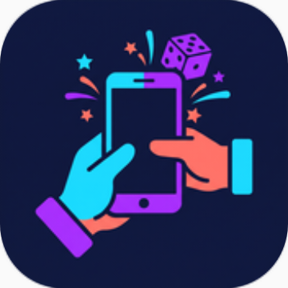

<h1 align="center">Gamenight GR</h1>

<b>54 παιχνίδια παρέας σε ένα κινητό.</b> 
Ένα κινητό, που περνάει από χέρι σε χέρι. Χωρίς internet, χωρίς λογαριασμό, χωρίς διαφημίσεις.

  

Android 10+ · 1 έως 7 παίκτες ή ομάδες · ελληνικά και English · ανοιχτός κώδικας (MIT) · offline · αυτόματες ενημερώσεις

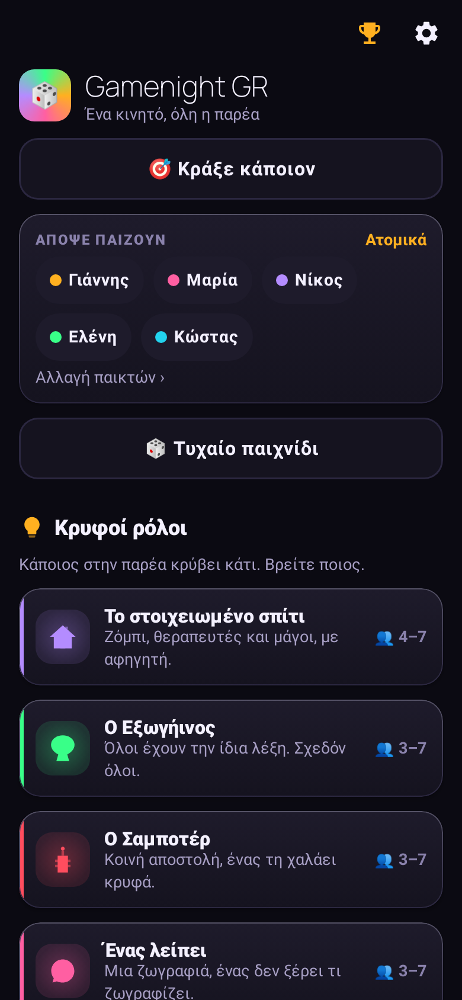
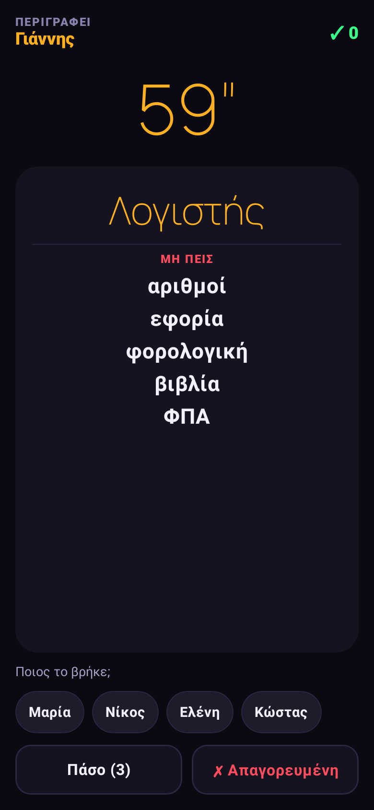
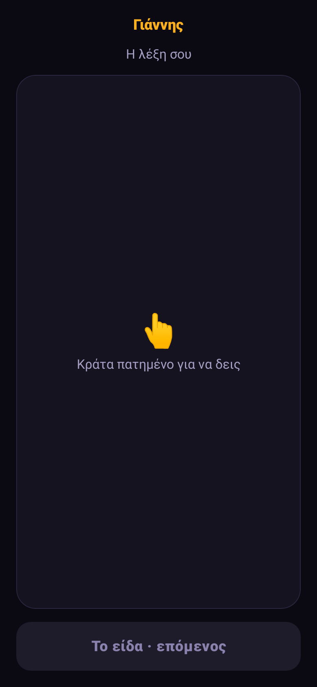
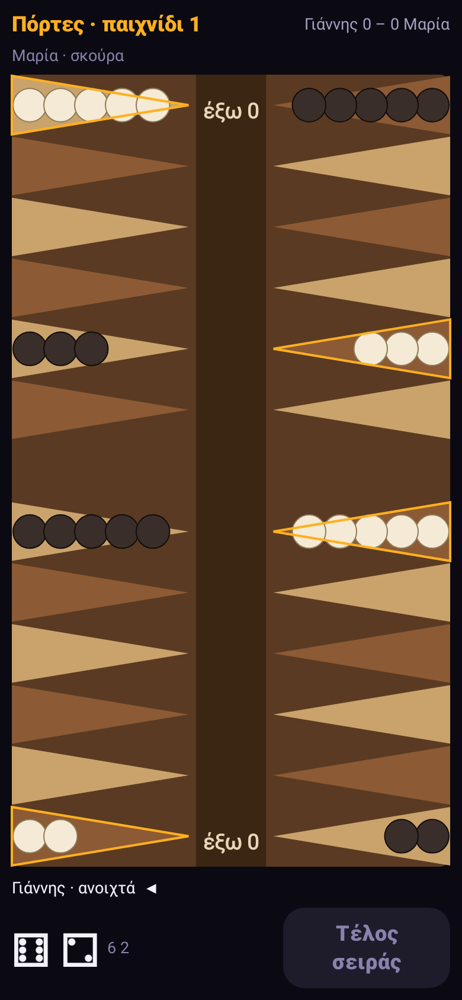

*[English below](#english)*

## Τι είναι

Μια εφαρμογή για βραδιές με φίλους. Γράφετε τους παίκτες (ή φτιάχνετε ομάδες), διαλέγετε παιχνίδι και το κινητό πηγαίνει από χέρι σε χέρι. Οι πόντοι μαζεύονται σε όλα τα παιχνίδια της βραδιάς, και στο τέλος υπάρχει κατάταξη και απονομή βραβείων.

Όλο το περιεχόμενο (πάνω από 2.000 κάρτες) είναι γραμμένο από την αρχή στα ελληνικά, με ελληνικά τραγούδια, ταινίες, φαγητά και πειράγματα. Υπάρχει και αγγλική έκδοση για τις ξένες παρέες.

## Τα παιχνίδια

| | Κατηγορία | Παιχνίδια |
|---|---|---|
| 🕵️ | **Κρυφοί ρόλοι** | 🏚️ Το στοιχειωμένο σπίτι (με αφηγητή) · 👽 Ο Εξωγήινος · 🧨 Ο Σαμποτέρ · 🎨 Ένας λείπει · 🤫 Ψίθυρος στο σκοτάδι · 🕶️ Ο κατάσκοπος στο σπίτι · 🗼 Πύργος από ψέματα |
| 🗣️ | **Λέξεις** | 🗣️ Πες το αλλιώς · 🤳 Στο μέτωπο · 🟨 Τετράδες · 💣 Ναρκοπέδιο · 🔟 Βρες 10 · 🔗 Σχετικές λέξεις |
| 🎉 | **Παρέα** | 👉 Ποιος από εμάς; · 🪞 Πόσο με ξέρεις; · 😳 Ζάρι της ντροπής · 🍾 Ρουλέτα μπουκαλιού |
| 🤥 | **Μπλόφα και γνώσεις** | 🃏 Ο Μπλοφατζής · 🤥 Ψέμα υπό πίεση · 🔍 Ο Μάρτυρας · 🎬 Μάντεψε την ταινία ή σειρά · 📏 Το κοντινότερο · 🛎️ Κουίζ γειτονιάς (buzzer στις γωνίες) |
| 🎭 | **Θέατρο, τραγούδι, ζωγραφική** | 🔢 Το νούμερό σου · 📞 Χαλασμένο τηλέφωνο · 🎤 Λέξη σε τραγούδι · 🔊 Αλυσίδα ήχων · 🙊 Μίμηση με κανόνα |
| ⚡ | **Αντανακλαστικά** | ⏱️ Βόμβα · ⚖️ Ισορροπία (με το γυροσκόπιο) |
| 📱 | **Με κίνηση** | 🛸 Το ανθρώπινο drone · 🤲 Αφόπλισε τη βόμβα · 🧊 Trivia σε ισορροπία · 🔐 Χρηματοκιβώτιο |
| 🎮 | **Arcade** | 🌈 Χρωματική πύλη · 🕳️ Βουτιά · 🔢 Γρήγορο πλέγμα · 🪐 Τροχιά · ✂️ Κόψε και ταίριαξε · 🏗️ Πύργος · ✨ Φωτεινή διαδρομή · 🎯 Σφεντόνα · ↔️ Διπλή αποφυγή · 💫 Αναπήδηση σε δακτύλιο · 🟥 Πλέγμα λέιζερ · 🛡️ Σπείρα. Μόνος σου για ρεκόρ ή κόντρα στην παρέα |
| 🎲 | **Επιτραπέζια** | 🎲 Τάβλι: Πόρτες, Πλακωτό και Φεύγα για δύο, με τους κανονικούς κανόνες |
| 🧠 | **Λογική** | ⚛️ Ο Πυρήνας: 40 επίπεδα με κόμβους και σήματα, χωρίς τύχη |
| 🤖 | **Με AI** (δικό σου κλειδί) | 🔦 Ο Ανακριτής · 🖍️ Ζωγράφισε για το AI · ♾️ Ατελείωτες κάρτες · 🧑‍⚖️ Δικαστήριο · 🤖 Ποιος είναι το AI; · 🔮 Ο Μάντης |

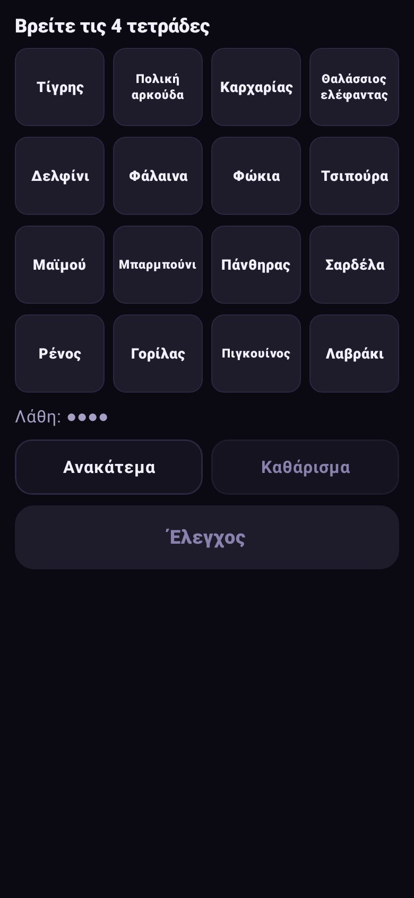
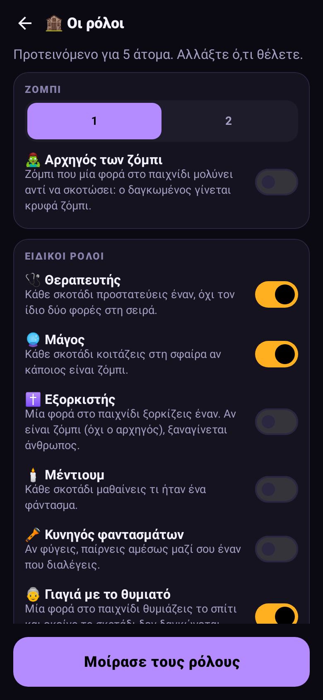
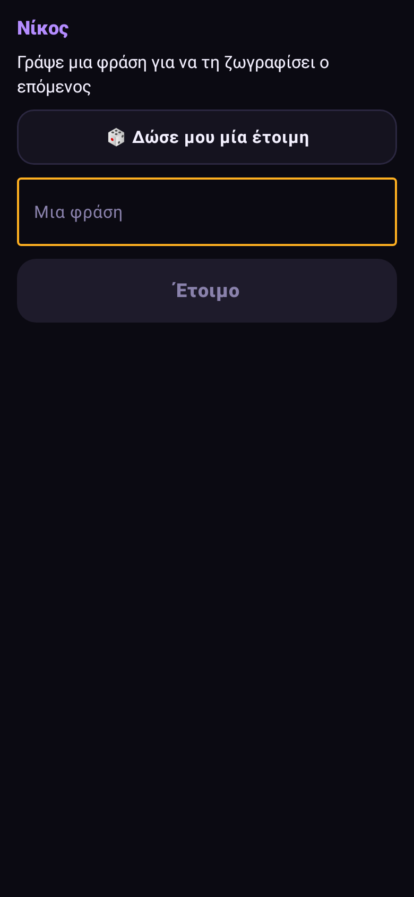
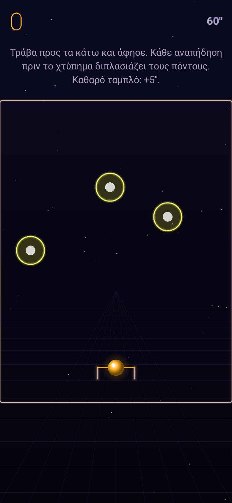
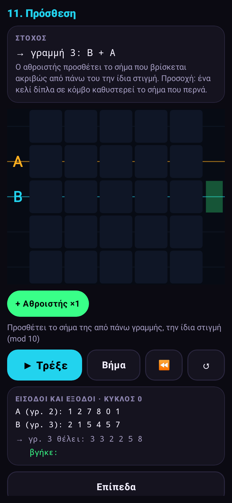

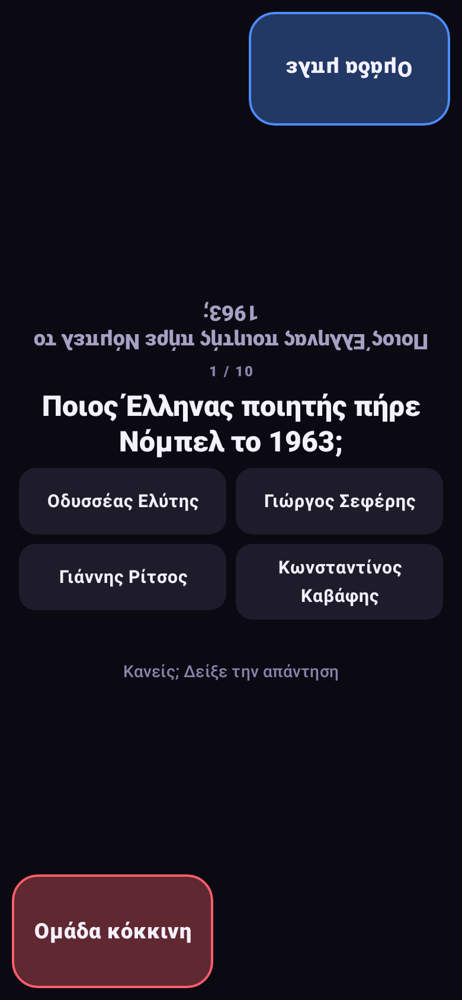

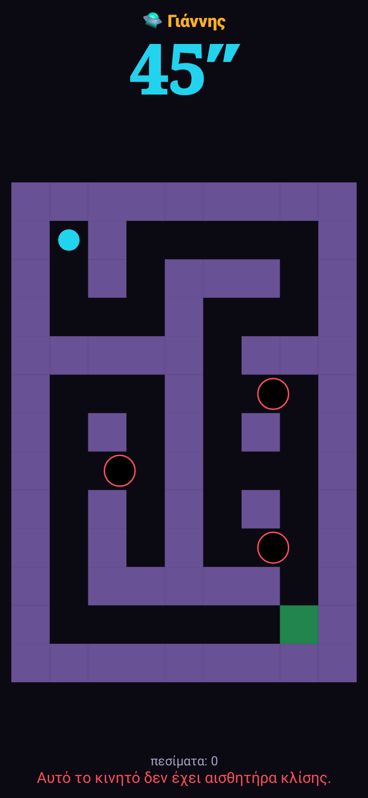
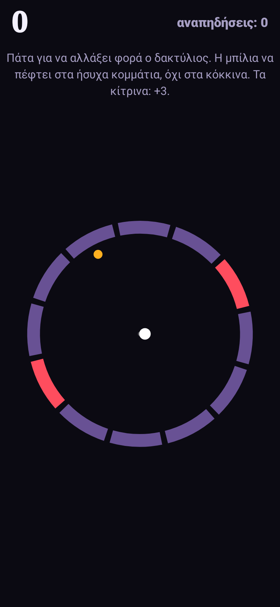
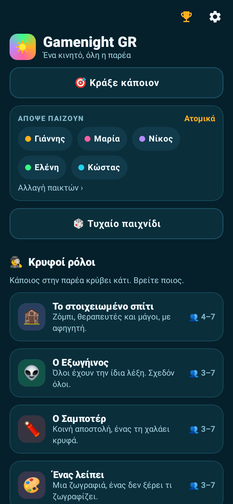

## Ακόμα

- **📦 Πακέτα καρτών** από το GitHub («Ποδόσφαιρο», «Ταινίες 90s», «Κρήτη») και **δικές σας λέξεις** («ο σκύλος του Νίκου»), που μπαίνουν σε όλα τα παιχνίδια λέξεων. Ρυθμίσεις → 📦.
- **📜 Ιστορικό βραδιών:** ποιος κέρδισε πόσες βραδιές, με σερί νικών. Μια βραδιά κρατιέται όταν πατήσετε «Νέα βραδιά».
- **Εμφάνιση:** 🎲 Βραδιά, ☀️ Καλοκαίρι ή 🎄 Χριστούγεννα, με άλλα χρώματα και ήχους νίκης.

## 🌀 Χάος

Αν το ανοίξεις (είναι ανοιχτό από την αρχή), ανάμεσα στους γύρους πέφτουν μικρές αστείες εκπλήξεις: ποινές, δώρα, κατάρες, ένας σερίφης που φορολογεί, μονομαχίες. Η εφαρμογή λέει μετά σε ποιον να δοθεί το κινητό, χωρίς να δείξει τίποτα μέχρι να το πάρει. Υπάρχει και το κουμπί **🎯 Κράξε κάποιον**, μία φορά κάθε 5 λεπτά. Τίποτα από αυτά δεν εμφανίζεται μέσα σε γύρο με χρονόμετρο ή σε κρυφή οθόνη.

## 🎙️ Ο Χαβαλές (AI, προαιρετικό)

Ένας AI πειραχτήρι που πού και πού πετάγεται ανάμεσα στους γύρους και πειράζει την παρέα με βάση ό,τι έγινε απόψε, κράζει όποιον διαλέξεις στο «🎯 Κράξε» και γράφει την **ιστορία της βραδιάς**. Θέλει δικό σου κλειδί (Gemini, Groq και OpenRouter έχουν δωρεάν κλειδί χωρίς κάρτα, ή DeepSeek). Υπάρχει διακόπτης για ελαφριές, φιλικές βρισιές. Με το ίδιο κλειδί παίζονται και τα 6 παιχνίδια 🤖 AI. Όλα τα άλλα δουλεύουν και χωρίς αυτό.

## Εγκατάσταση

1. Πάτα **Download APK** πιο πάνω, από τον browser του κινητού.
2. Άνοιξε το αρχείο και επέτρεψε την «εγκατάσταση από άγνωστες πηγές».
3. Γράψε τους παίκτες και διάλεξε παιχνίδι.

Οι νέες εκδόσεις εμφανίζονται στην αρχική οθόνη: ένα πάτημα, και κατεβαίνει και εγκαθίσταται.

## Ιδιωτικότητα

Τα ονόματα, οι πόντοι και τα ρεκόρ μένουν μόνο στο κινητό. Δεν υπάρχει λογαριασμός, server, διαφημίσεις ή analytics. Το internet χρησιμοποιείται μόνο για τον έλεγχο νέας έκδοσης και τα πακέτα καρτών (στο GitHub), και για τον Χαβαλέ και τα παιχνίδια AI, αν βάλεις κλειδί. Δες το [PRIVACY.md](PRIVACY.md).

## Πρόβλημα;

Ρυθμίσεις → 🐞 Αναφορά προβλήματος: ετοιμάζει email στο info@3wsol.gr με την έκδοση και το κινητό, χωρίς τα ονόματα των παικτών. Ή άνοιξε ένα [issue](https://github.com/jemangr/Gamenight-GR/issues).

---

## English

**Gamenight GR**: 54 party games on one phone that goes from hand to hand. Offline, no account, no ads. Android 10+, 1 to 7 players or teams, Greek and English content.

- **Hidden roles:** The haunted house (with a narrator), The Alien, The Saboteur, One is missing, Whisper in the dark, The spy at home, Tower of lies.
- **Words:** Say it otherwise, On your forehead, Fours, Minefield, Find 10, Related words.
- **Party:** Who of us?, How well do you know me?, Dice of shame, Spin the bottle.
- **Bluff and trivia:** The Bluffer, Lie under pressure, The Witness, Guess the film or series, Closest wins, Neighbourhood quiz (a buzzer in each corner).
- **Acting, singing, drawing:** Your number, Broken telephone, Word in a song, Sound chain, Mime with a rule.
- **Reflexes:** Bomb, Balance (gyroscope).
- **Motion:** The human drone, Defuse the bomb, Balance trivia, The safe.
- **Arcade:** 12 one-touch games, alone for a record or against the group.
- **Board games:** Backgammon (Portes, Plakoto, Fevga) for two on one phone.
- **Logic:** The Core, 40 levels of nodes and signals, no luck.
- **With AI** (your own key): The interrogator, Draw for the AI, Endless cards, Courtroom, Who is the AI?, The Oracle.

**Also:** card packs from GitHub and your own words, a history of past nights with winning streaks, and Night, Summer or Christmas looks.

**🌀 Chaos** drops small funny surprises between rounds (penalties, gifts, curses, a sheriff, duels) and adds a «🎯 Roast someone» button, once every 5 minutes. Never during a timed round or a secret screen.

**🎙️ Havales (optional AI)** teases the group from what happened tonight and writes the story of the night, with your own key (Gemini, Groq and OpenRouter have free keys). The same key plays the 6 AI games.

**Install:** tap **Download APK** above on your phone, allow “unknown sources”, add the players and pick a game. New versions show up on the home screen and install with one tap.

**Privacy:** names, points and records stay on the phone. The internet is used only for the update check and card packs (GitHub), and for Havales and the AI games, if you add a key. See [PRIVACY.md](PRIVACY.md).

## License

MIT © 2026 jemangr. The game mechanics recall well-known party games; all the content, code and graphics are our own.
